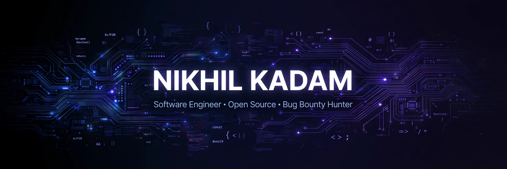

  

  

B.E. Computer Science student from Nashik, India — turning coffee into code and bugs into bounties. 🐛💰

  

---

### 🚀 About Me

- 🎓 B.E. Computer Science @ Sandip Institute of Technology & Research Centre
- 💼 Founder of an e-commerce initiative *(Sept 2025 – present)*
- 🌱 Campus Ambassador @ E-Cell, IIT Kanpur
- 🎭 College Leader @ Mood Indigo, IIT Bombay
- 💻 Code in Place 2025 (Stanford)
- 🎯 Right now: hunting open-source bug bounties and shipping fixes daily

### 🛠️ Tech Stack

### 🌱 Currently Learning

### 📊 GitHub Stats

  
  

  

### 💡 Random Dev Quote

  

### 😄 Random Dev Joke

  

### 🐍 Watch the snake eat my contributions

### 🏔️ 3D Contribution Graph

  

### 📫 Let's Connect

  
  

- 📧 Open a GitHub issue on any of my repos — I read everything

  

